# Project guide: fuzzy–neural character recognizer

This guide explains the whole project: what it does, every syllabus topic it uses (and the ones it does not), how each piece of code works, how the experiments were run, what the results mean, and the questions you are likely to be asked in a viva.

The short [README](README.md) covers running the code. The [project report](report/Fuzzy-Neural-Character-Recognition-Report.pdf) is the formal write-up. This guide is the study companion that connects the two. A printable copy is in [report/Fuzzy-Neural-Character-Recognition-Guide.pdf](report/Fuzzy-Neural-Character-Recognition-Guide.pdf).

## Contents

1. [The project in one page](#1-the-project-in-one-page)
2. [Quick start](#2-quick-start)
3. [How data flows through the system](#3-how-data-flows-through-the-system)
4. [Syllabus map: what is used, where, and how](#4-syllabus-map-what-is-used-where-and-how)
5. [Unit 1: neurons, Hebbian learning, perceptron](#5-unit-1-neurons-hebbian-learning-perceptron)
6. [Unit 2: feedback networks (Hopfield)](#6-unit-2-feedback-networks-hopfield)
7. [Unit 3: Hamming net, Maxnet, associative memories](#7-unit-3-hamming-net-maxnet-associative-memories)
8. [Unit 4: fuzzy sets, membership, fuzzification, defuzzification](#8-unit-4-fuzzy-sets-membership-fuzzification-defuzzification)
9. [Unit 5: fuzzy rules and inference](#9-unit-5-fuzzy-rules-and-inference)
10. [Syllabus topics not implemented, and how they relate](#10-syllabus-topics-not-implemented-and-how-they-relate)
11. [Code tour, file by file](#11-code-tour-file-by-file)
12. [The experiments](#12-the-experiments)
13. [Results and what they mean](#13-results-and-what-they-mean)
14. [Design decisions and why they were made](#14-design-decisions-and-why-they-were-made)
15. [The interactive demo](#15-the-interactive-demo)
16. [The self-tests](#16-the-self-tests)
17. [Viva questions and answers](#17-viva-questions-and-answers)
18. [Glossary](#18-glossary)

---

## 1. The project in one page

**Problem.** Scanned or photographed text is rarely clean. Ink fades, paper turns grey and noise scatters specks across the page. If you simply threshold such an image (every pixel above 0.5 is ink, everything else is paper), you lose stroke pixels and gain false ones.

**Idea.** "Is this pixel ink?" is a matter of degree, which is exactly what fuzzy logic handles. A fuzzy rule system decides each pixel from its own value **and** its neighbourhood, the way a person would. Neural networks from the syllabus then recognise or recall the cleaned character.

**What was built.**

- 36 characters (A–Z, 0–9) as 24×24 images.
- Three kinds of damage: Gaussian noise, salt-and-pepper noise, and faded scans.
- A **fuzzy enhancement stage**, written from scratch in numpy: fuzzification, the INT operator, and a 9-rule Mamdani inference system with centroid defuzzification.
- Four **neural networks**, also from scratch: a perceptron, a Hamming net with Maxnet, a Hopfield network (two storage rules) and a bidirectional associative memory (BAM).
- **Experiments** that feed the *same* noisy images to every network twice: once thresholded, once fuzzy-enhanced.
- An **interactive demo** (`gui.py`) and **14 self-tests** (`selftest.py`).

**Headline results.**

- The fuzzy stage cuts pixel errors by more than half under random noise: 10.5% → 4.2% (Gaussian, σ = 0.4) and 15.0% → 7.0% (30% salt-and-pepper).
- On faded scans it raises recognition accuracy: perceptron 88.1% → 94.4%, Hopfield 92.6% → 98.3%, BAM 96.3% → 98.7% (σ = 0.25).
- Under plain random noise the networks are already close to 100% with or without it, and at the most extreme noise the fuzzy filter stops helping.

---

## 2. Quick start

You need Python 3 with numpy, matplotlib and Pillow (tkinter comes with Python). Nothing else is required.

```
python selftest.py      # 14 correctness checks, about 4 s
python checkpoint.py    # fuzzy stage alone: pixel errors with and without it
python experiments.py   # every experiment; figures and CSVs into results/, about 40 s
python gui.py           # interactive demo
```

All randomness uses fixed seeds, so you will get exactly the numbers in this guide.

---

## 3. How data flows through the system

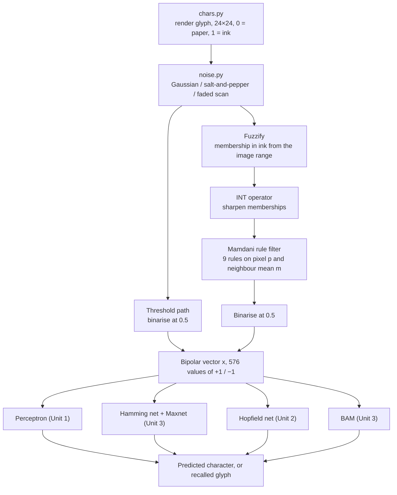

**Two representations are used:**

| Where | Values | Why |
|---|---|---|
| Images and the fuzzy stage | Real numbers in [0, 1]; 0 = paper, 1 = ink | Fuzzy logic needs degrees, not just yes or no |
| Network input | Bipolar vector of 576 values, +1 = ink, −1 = paper | The textbook versions of Hopfield, Hamming and BAM are defined on bipolar vectors |

`chars.to_bipolar` converts an image to a bipolar vector (threshold at 0.5, then flatten 24×24 to 576), and `chars.from_bipolar` converts back for display.

---

## 4. Syllabus map: what is used, where, and how

The course is **EEO1003 Fuzzy Logic and Neural Networks**. ✅ = implemented and used; 🔶 = used as an idea inside something else; ⬜ = not implemented (section 10 explains how each one relates).

| Unit | Syllabus topic | Status | Where in this project |
|---|---|---|---|
| 1 | Biological neuron, models of ANN | 🔶 | Every network uses threshold neurons that sum weighted inputs and fire ±1 |
| 1 | Characteristics and types of learning | 🔶 | Supervised (perceptron), Hebbian storage (Hopfield, BAM), fixed weights (Hamming, Maxnet) |
| 1 | McCulloch–Pitts neuron | 🔶 | The Hopfield and BAM neurons are McCulloch–Pitts style threshold units |
| 1 | Hebbian learning | ✅ | `hopfield.py` (Hebbian rule), `bam.py` (weight matrix) |
| 1 | Perceptron | ✅ | `perceptron.py`, classifies all 36 characters |
| 1 | Delta rule, Adaline, Madaline | ⬜ | Section 10 |
| 2 | Back propagation | ⬜ | Section 10 |
| 2 | Radial basis function network | ⬜ | Section 10 |
| 2 | Hopfield net, discrete | ✅ | `hopfield.py`, asynchronous recall with an energy function |
| 2 | Hopfield net, continuous | ⬜ | Section 10 |
| 3 | Kohonen self-organising map, LVQ | ⬜ | Section 10 |
| 3 | Maxnet | ✅ | `hamming.py` (`Maxnet`), picks the winning character |
| 3 | Hamming net | ✅ | `hamming.py` (`HammingNet`), scores the input against each template |
| 3 | Auto-associative memory | ✅ | The Hopfield net recalls the glyph itself |
| 3 | Hetero-associative memory, BAM | ✅ | `bam.py`, links each glyph to a class code, in both directions |
| 4 | Classical sets vs fuzzy sets | ✅ | Thresholding (crisp) vs fuzzy membership of "ink" |
| 4 | Operations and properties of fuzzy sets | ✅ | AND = min, aggregation = max, INT operator |
| 4 | Crisp and fuzzy relations | 🔶 | The rule base acts as a fuzzy relation; inference is max–min composition |
| 4 | Membership functions | ✅ | Trapezoids and triangles in `fuzzy.py` |
| 4 | Fuzzification | ✅ | `fuzzy.fuzzify`, `fuzzy.fuzzify_image` |
| 4 | Defuzzification | ✅ | Centroid, in `fuzzy.infer` |
| 5 | Formation of rules | ✅ | 9 IF–THEN rules in `fuzzy.RULES` |
| 5 | Decomposition of rules | ✅ | Compound conditions (p AND m) combined with min |
| 5 | Aggregation of rules | ✅ | Max over all rule outputs |
| 5 | Properties of fuzzy rules | ✅ | The rule base is complete and consistent (section 9) |
| 5 | Fuzzy inference system | ✅ | Mamdani FIS in `fuzzy.infer` |
| 5 | Applications: image processing | ✅ | The whole fuzzy stage is an image-enhancement application |

**Course outcomes:**

| Outcome | How the project meets it |
|---|---|
| CO1: concepts, structures, implementation of algorithms | Every network and the fuzzy system implemented from their equations, no ML library |
| CO2: design applications of neural networks | Noisy character recognition and associative recall |
| CO3: apply rule-based fuzzy logic | 9-rule Mamdani system for image enhancement |
| CO4: fuzzy logic in engineering | Fuzzy pre-processing for a recognition system, tested under three kinds of image damage |

---

## 5. Unit 1: neurons, Hebbian learning, perceptron

### 5.1 The artificial neuron used everywhere

Every network here is built from the same simple neuron, the McCulloch–Pitts threshold unit extended to bipolar values:

$$
y_{in} = b + \sum_i x_i w_i, \qquad y = \begin{cases} +1 & y_{in} > \theta \\ -1 & y_{in} < -\theta \end{cases}
$$

The neuron adds up its weighted inputs and fires +1 or −1 depending on which side of the threshold the sum falls. What differs between networks is **how the weights are set** and **how neurons are connected**.

| Network | How weights are set | Connections |
|---|---|---|
| Perceptron | Learned from examples (supervised) | Feed-forward, one layer |
| Hamming net | Fixed, copied from the templates | Feed-forward |
| Maxnet | Fixed: self 1, others −ε | Fully connected, recurrent |
| Hopfield net | Stored with the Hebbian (or projection) rule | Fully connected, recurrent |
| BAM | Stored with the Hebbian rule | Two layers, connected both ways |

### 5.2 Hebbian learning

Hebb's rule says: *a connection grows stronger when the two neurons it joins are active together.* For bipolar patterns the weight change is the product of the two activities:

$$
\Delta w_{ij} = x_i \, y_j
$$

Over several patterns this sums into an **outer product**, W = Σ x yᵀ. The project uses it in two places:

- **Hopfield** (`hopfield.py`, `store(rule="hebbian")`): `W = P.T @ P`, then the diagonal is set to zero. Each neuron is connected to every other.
- **BAM** (`bam.py`, `store`): `W = X.T @ codes`, linking the 576 image neurons to the 16 code neurons.

### 5.3 The perceptron

**File:** `perceptron.py`, class `Perceptron`. **Trained by:** `models.build`.

**Architecture.** 576 inputs (one per pixel) and 36 output units (one per character). Output unit j computes

$$
y_{in,j} = b_j + \sum_i x_i w_{ij}, \qquad y_j = \begin{cases} 1 & y_{in,j} > \theta \\ 0 & -\theta \le y_{in,j} \le \theta \\ -1 & y_{in,j} < -\theta \end{cases}
$$

The middle case (0) is the perceptron's "undecided" band. The code uses θ = 0.

**Learning rule.** Each training image has target t_j = +1 for its own character and −1 for all others. Whenever an output unit's response y_j differs from its target, its weights move towards the target:

$$
w_{ij} \leftarrow w_{ij} + \alpha \, t_j \, x_i, \qquad b_j \leftarrow b_j + \alpha \, t_j
$$

Only the units that were wrong are updated. Training stops after an epoch with no errors.

**Worked example (one update).** Input x = (1, −1, 1), weights all 0, bias 0, target t = 1, α = 1:

- y_in = 0 + 0 = 0, so y = 0 (undecided). That is not the target, so update.
- New weights w = 0 + 1·1·(1, −1, 1) = (1, −1, 1). New bias b = 0 + 1 = 1.
- Next time, y_in = 1 + (1 + 1 + 1) = 4 > 0, so y = 1. Correct.

**How it is used here.**

- Training data: the 36 clean glyphs plus 1,440 noisy copies (10 copies × 36 characters × 4 noise settings: Gaussian σ = 0.2 and 0.3, salt-and-pepper 5% and 10%).
- It converges in 3 epochs.
- To classify, the code picks the output unit with the **largest net input** (`predict` uses `argmax`). This always gives one answer, even when several units fire.
- It is trained **twice**, once per signal path. The fuzzy-path perceptron is trained on fuzzy-enhanced images, the threshold-path perceptron on thresholded ones. Both use the same noisy images, so each is tested on the kind of input it learned from (section 14).

---

## 6. Unit 2: feedback networks (Hopfield)

**File:** `hopfield.py`, class `Hopfield`.

### 6.1 Architecture

A discrete Hopfield network is a single layer of 576 neurons, one per pixel, each connected to every other. The weights are symmetric (w_ij = w_ji) with no self-connections (w_ii = 0). It is **auto-associative**: given a damaged pattern, it returns the stored pattern itself.

### 6.2 Storage: two rules

**Hebbian rule (syllabus).**

$$
W = \sum_k \mathbf{p}^k (\mathbf{p}^k)^T, \qquad w_{ii} = 0
$$

**Projection (pseudo-inverse) rule (extension beyond the syllabus).**

$$
W = P^{+} P, \qquad w_{ii} = 0
$$

Here P holds one stored pattern per row and P⁺ is its Moore–Penrose pseudo-inverse. This rule makes every stored pattern an exact stable state, even when the patterns overlap heavily. Section 6.5 explains why it was needed.

### 6.3 Recall

Recall starts from the input image and updates **one neuron at a time, in random order** (asynchronous updating):

$$
s_i \leftarrow \operatorname{sign}\Big(\sum_j w_{ij} s_j\Big)
$$

If the sum is exactly 0, the neuron keeps its value. A *sweep* visits every neuron once; recall stops when a full sweep changes nothing. The final state is compared with the stored glyphs. If it equals one exactly, that glyph is the answer. Otherwise the network has fallen into a **spurious state**, which counts as wrong.

### 6.4 The energy function

$$
E = -\tfrac{1}{2} \sum_i \sum_j w_{ij} s_i s_j
$$

**Why recall always stops.** When neuron i flips by Δs_i, the energy changes by ΔE = −Δs_i · h_i, where h_i = Σ_j w_ij s_j is the neuron's input. A neuron only flips to match the sign of h_i, so Δs_i and h_i have the same sign and ΔE ≤ 0. The energy can never rise, and it is bounded below, so recall must settle. This needs symmetric weights and a zero diagonal, which both storage rules guarantee. `selftest.py` checks it on real recalls.

**Worked example (6 neurons, Hebbian).** Store p¹ = (1, 1, 1, −1, −1, −1) and p² = (1, −1, 1, −1, 1, −1). The Hebbian rule gives

```
W =  [  0  0  2 -2  0 -2 ]
     [  0  0  0  0 -2  0 ]
     [  2  0  0 -2  0 -2 ]
     [ -2  0 -2  0  0  2 ]
     [  0 -2  0  0  0  0 ]
     [ -2  0 -2  2  0  0 ]
```

- Start from p¹ with neuron 3 flipped: s = (1, 1, **−1**, −1, −1, −1). Energy E = −2.
- When neuron 3 is visited: h₃ = 2·1 + 0·1 + (−2)(−1) + 0·(−1) + (−2)(−1) = 6 > 0, so it flips back to +1.
- Final state (1, 1, 1, −1, −1, −1) = p¹. Energy E = −14. The damaged bit was repaired and the energy fell.

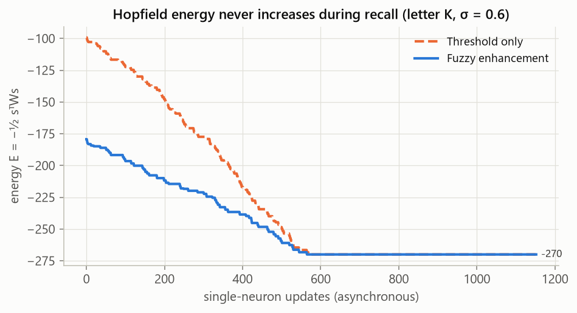

*Recall of a noisy "K" (σ = 0.6) on both paths. Energy only goes down. Both runs end at −270, the energy of every stored glyph under the projection rule. The fuzzy input starts lower, already closer to the answer.*

### 6.5 Capacity: why the Hebbian net stores only 3 glyphs

A Hebbian Hopfield net can hold about **0.138 n** *random* patterns, which is about 79 for n = 576. Letters are far from random: they share a large white background and many stroke positions. With K stored patterns, the input to neuron i when the net sits in pattern μ is its own signal plus **crosstalk** from every other stored pattern:

$$
h_i = \underbrace{(n-K)\,p^{\mu}_i}_{\text{signal}} + \underbrace{\sum_{k\ne\mu} p^k_i \,(\mathbf{p}^k\cdot\mathbf{p}^{\mu})}_{\text{crosstalk}}
$$

The −K comes from setting the diagonal to zero. When patterns overlap strongly, the dot products p^k · p^μ are large and the crosstalk swamps the signal.

The glyphs were added in a greedy order, each as different as possible from those already chosen (`subset.greedy_order`). In that order the Hebbian rule kept every pattern stable only up to 3 glyphs, and none at all from 5 glyphs on. So:

- The **Hebbian Hopfield net and BAM** store the largest stable greedy set: **W, Q, D**.
- The **projection-rule Hopfield net** stores all 36 and is the one compared with the perceptron and Hamming net.

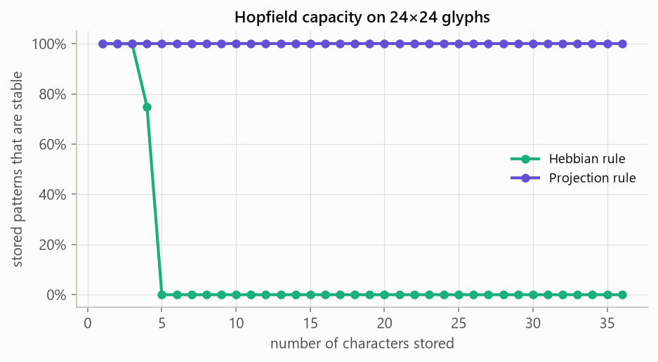

---

## 7. Unit 3: Hamming net, Maxnet, associative memories

### 7.1 Hamming net

**File:** `hamming.py`, class `HammingNet`.

The Hamming net is a **minimum-distance classifier**. It stores one template eʲ per character (the clean bipolar glyph) and measures how close the input is to each one. With weights eʲ/2 and bias n/2, its net input is exactly the number of pixels that agree:

$$
y_{in,j} = \frac{n}{2} + \frac{1}{2}\,\mathbf{x}\cdot\mathbf{e}^j = n - HD(\mathbf{x}, \mathbf{e}^j)
$$

**Why it works.** For bipolar vectors, x · e = (agreements) − (disagreements) = n − 2·HD. Adding n and halving gives n − HD.

**Example from the demo.** A noisy "A" (Gaussian, σ = 0.4) on the threshold path agrees with the "A" template on 530 of 576 pixels. After fuzzy enhancement it agrees on 563.

The Hamming net needs no training; its weights are the templates. It feeds its 36 scores to the Maxnet.

### 7.2 Maxnet

**File:** `hamming.py`, class `Maxnet`.

Maxnet is a **winner-take-all** network. Each of its m units excites itself (weight 1) and inhibits every other unit (weight −ε, with 0 < ε < 1/m). It repeats

$$
a_j \leftarrow \max\Big(0,\; a_j - \varepsilon \sum_{k\ne j} a_k\Big)
$$

until only one unit is still positive. That unit is the winner. The code uses ε = 1/(2m) = 1/72.

**Worked example.** Three units with activations (5, 4, 2) and ε = 0.2:

| Iteration | Unit 1 | Unit 2 | Unit 3 |
|---|---|---|---|
| start | 5 | 4 | 2 |
| 1 | 3.8 | 2.6 | 0.2 |
| 2 | 3.24 | 1.8 | 0 |
| 3 | 2.88 | 1.152 | 0 |
| 4 | 2.65 | 0.576 | 0 |
| 5 | 2.534 | 0.046 | 0 |
| 6 | 2.525 | 0 | 0 |

Unit 1, the largest at the start, is the only one left.

**Ties.** If two units start exactly equal, they fall in lockstep and never separate. The code first subtracts a tiny amount that grows with the unit's index (index × 10⁻⁹ × the largest score), so the lower-numbered unit wins a perfect tie. The offset is far too small to change any result that is not a tie.

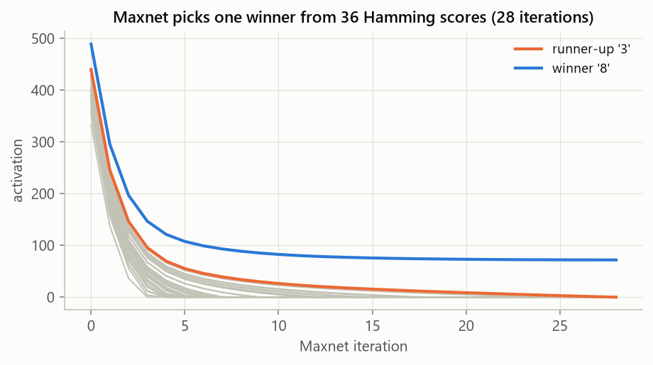

*Maxnet on a noisy "8": 36 Hamming scores compete until one is left.*

### 7.3 Auto-associative vs hetero-associative memory

| | Auto-associative | Hetero-associative |
|---|---|---|
| Stores | Pattern → the same pattern | Pattern → a different pattern |
| Recall gives back | A cleaned version of the input | The partner of the input |
| In this project | Hopfield net (glyph → glyph) | BAM (glyph ↔ class code) |

### 7.4 Bidirectional associative memory (BAM)

**File:** `bam.py`, class `BAM`.

BAM has two layers: X (576 image neurons) and Y (16 code neurons). Each stored glyph xᵏ is paired with a class code yᵏ. The weights follow Hebb's rule:

$$
W = \sum_k (\mathbf{x}^k)^T \mathbf{y}^k
$$

Recall bounces between the layers until neither changes:

$$
\mathbf{y} \leftarrow \operatorname{sign}(\mathbf{x} W), \qquad \mathbf{x} \leftarrow \operatorname{sign}(\mathbf{y} W^T)
$$

The answer is the stored code nearest to the final y.

**Why Hadamard codes.** The class codes are rows of a 16×16 Hadamard matrix (`hadamard_codes`). Any two rows are orthogonal, so the codes are as far apart as 16-bit codes can be, which makes them easy to tell apart. The all-ones row is skipped.

**Worked example.** Store x¹ = (1, 1, 1, −1, −1, −1) ↔ y¹ = (1, 1, −1) and x² = (−1, 1, −1, 1, −1, 1) ↔ y² = (−1, 1, 1).

```
W =  [  2  0 -2 ]
     [  0  2  0 ]
     [  2  0 -2 ]
     [ -2  0  2 ]
     [  0 -2  0 ]
     [ -2  0  2 ]
```

- Input: x¹ with the last bit flipped, (1, 1, 1, −1, −1, **1**).
- x W = (4, 4, −4), so y = (1, 1, −1) = y¹. The right code.
- y Wᵀ = (4, 2, 4, −4, −2, −4), so x = (1, 1, 1, −1, −1, −1) = x¹. The damaged bit is repaired.
- The next pass changes nothing, so recall stops after 2 passes.

---

## 8. Unit 4: fuzzy sets, membership, fuzzification, defuzzification

**File:** `fuzzy.py`. The fuzzy stage runs in `enhance` (with every intermediate image available from `enhance_stages`).

### 8.1 Classical sets vs fuzzy sets, in this project

| | Classical (crisp) set | Fuzzy set |
|---|---|---|
| Membership | 0 or 1 | Any degree from 0 to 1 |
| Here | Thresholding: a pixel is ink if its value ≥ 0.5, else paper | A pixel of value 0.6 is "medium" to degree 0.8 and "high" to degree 0.2 at the same time |
| Consequence | A pixel at 0.49 and one at 0.01 are treated the same | The degree carries information into the rules |

### 8.2 Membership functions

All membership functions are trapezoids, written `trapmf(x, a, b, c, d)`: 0 below a, rising to 1 at b, flat until c, falling to 0 at d. A triangle is the case b = c.

$$
\mu(x) = \max\Big(0,\; \min\Big(\frac{x-a}{b-a},\; 1,\; \frac{d-x}{d-c}\Big)\Big)
$$

| Variable | low (a, b, c, d) | medium (a, b, c, d) | high (a, b, c, d) |
|---|---|---|---|
| Pixel value p (`INPUT_MF`) | 0, 0, 0.2, 0.45 | 0.2, 0.45, 0.55, 0.8 | 0.55, 0.8, 1, 1 |
| Neighbour mean m (`NEIGHBOUR_MF`) | 0, 0, 0.2, 0.4 | 0.2, 0.4, 0.7, 0.9 | 0.7, 0.9, 1, 1 |
| Output (`OUTPUT_MF`) | 0, 0, 0.1, 0.35 | 0.3, 0.5, 0.5, 0.7 | 0.65, 0.9, 1, 1 |

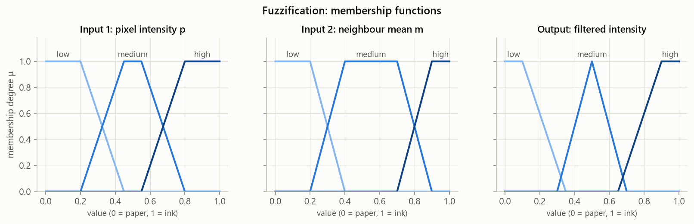

**Properties worth knowing:**

- Every set is **normal** (reaches 1) and **convex** (one hump, no dips).
- For both inputs, the three sets form a **fuzzy partition**: at every value the memberships add up to 1. Every input therefore belongs somewhere, and some rule always fires.

**Why the neighbour sets have those breakpoints.** Strokes are about 3 pixels wide:

| Situation | Typical neighbour mean m | Fuzzy set |
|---|---|---|
| Pixel inside a stroke | Close to 1 (almost all 8 neighbours are ink) | high |
| Pixel on a stroke edge | About 5/8 = 0.63 | medium |
| Paper next to a stroke | About 3/8 = 0.38 | mostly medium (0.9), a little low (0.1) |
| Open paper | About 0 | low |

"Low" ends at 0.4, so a lone speck (few ink neighbours) is removed. "High" starts at 0.7, so holes inside strokes are filled but the inside corners of letters are not. The exact values came from a grid search (section 14).

### 8.3 Fuzzification

Two kinds of fuzzification happen.

**Of the image** (`fuzzify_image`): each pixel's membership in "ink" is measured against the image's own range, from its 5th percentile (paper) to its 95th percentile (ink):

$$
\mu_{ink}(x) = \operatorname{clip}\Big(\frac{x - x_{5\%}}{x_{95\%} - x_{5\%}},\; 0,\; 1\Big)
$$

A clean black-and-white glyph is unchanged, because its 5th and 95th percentiles are already 0 and 1. A faded scan with paper at 0.3 and ink at 0.6 is stretched so the paper becomes 0 and the ink becomes 1.

**Of the rule inputs** (`fuzzify`): each value p and m is turned into its three degrees (low, medium, high) using the membership functions above.

### 8.4 Operations on fuzzy sets

| Operation | Definition | Where it is used |
|---|---|---|
| Intersection (AND) | μ_A∩B = min(μ_A, μ_B) | Firing strength of a rule: min(μ_p, μ_m) |
| Union (OR) | μ_A∪B = max(μ_A, μ_B) | Aggregating rule outputs |
| Clipping | min(α, μ_C(u)) | Implication: each rule's output set is cut at its firing strength |
| Contrast intensification (INT) | See below | Sharpening memberships before the rule filter |

**The INT operator** (`intensify`) makes a fuzzy set less fuzzy by pushing memberships away from 0.5:

$$
INT(\mu) = \begin{cases} 2\mu^2 & \mu \le 0.5 \\ 1 - 2(1-\mu)^2 & \mu > 0.5 \end{cases}
$$

| μ | INT(μ) |
|---|---|
| 0.35 | 0.245 |
| 0.5 | 0.5 |
| 0.7 | 0.82 |

Note that INT keeps every value on the same side of 0.5, so INT followed by a 0.5 threshold gives the same result as the threshold alone. INT matters because the **rule filter** sees the sharpened values: the neighbour mean m is computed from the sharpened image, which separates strokes from paper more clearly.

### 8.5 Defuzzification

The rule system produces an aggregated fuzzy set over the output range. **Centroid defuzzification** turns it back into one number, its centre of gravity, computed over 101 points u from 0 to 1:

$$
u^{*} = \frac{\sum_u u\,\mu_{agg}(u)}{\sum_u \mu_{agg}(u)}
$$

Centroid was chosen because it uses the whole aggregated shape and changes smoothly as inputs change.

---

## 9. Unit 5: fuzzy rules and inference

### 9.1 Formation of rules

Each pixel has two inputs: **p**, its own value, and **m**, the mean of its 8 neighbours. With three sets each, there are 3 × 3 = 9 rules (`fuzzy.RULES`):

| IF p is … | AND m is low | AND m is medium | AND m is high |
|---|---|---|---|
| low | low | low | **high** (fill a hole in a stroke) |
| medium | low | medium | high |
| high | **low** (remove a speck) | high | high |

Read across a row:

- When the neighbourhood is **clearly paper** (m low), the output is paper, whatever the pixel says.
- When it is **clearly ink** (m high), the output is ink.
- When it is **mixed** (m medium), the pixel keeps its own value.

### 9.2 Properties of this rule base

- **Complete:** every combination of input sets has a rule, so every input fires at least one rule.
- **Consistent:** no two rules have the same IF part with different THEN parts.
- **Deliberately discontinuous in one place:** in the "p low" row, the output jumps from low to high as m goes from medium to high. That jump is the hole-filling behaviour the rules are meant to have.

### 9.3 Decomposition and aggregation

- **Decomposition:** a compound rule "IF p is A AND m is B" is split into its two simple conditions. They are combined with AND = min, which gives the rule's **firing strength** α = min(μ_A(p), μ_B(m)).
- **Aggregation:** the clipped output sets of all rules are combined with max into one fuzzy set.

### 9.4 The Mamdani inference system, step by step

`fuzzy.infer` runs these five steps for every pixel at once (vectorised with numpy):

1. **Fuzzify** p and m: their degrees in low / medium / high.
2. **Fire** each rule: α_r = min(μ(p), μ(m)).
3. **Imply**: clip each rule's output set at α_r.
4. **Aggregate**: take the max over all clipped sets.
5. **Defuzzify**: return the centroid.

$$
\mu_{agg}(u) = \max_r \min\big(\alpha_r,\, \mu_{C_r}(u)\big)
$$

**Relation to fuzzy relations (Unit 4).** Each rule "IF A AND B THEN C" defines a fuzzy relation between inputs and output, built with min. Steps 2–4 together are the **max–min composition** of the fuzzified inputs with the relation formed by all 9 rules.

### 9.5 Worked example: filling a hole in a stroke

A pixel inside a stroke was darkened by noise to **p = 0.35**. Its neighbourhood is mostly ink, **m = 0.80**. Thresholding alone would call it paper (0.35 < 0.5).

**Step 1, fuzzify:**

| | low | medium | high |
|---|---|---|---|
| μ(p = 0.35) | 0.4 | 0.6 | 0 |
| μ(m = 0.80) | 0 | 0.5 | 0.5 |

**Steps 2–3, fire the rules (only those with strength > 0):**

| Rule | Strength | Output set |
|---|---|---|
| p low AND m medium | min(0.4, 0.5) = 0.4 | low |
| p low AND m high | min(0.4, 0.5) = 0.4 | high |
| p medium AND m medium | min(0.6, 0.5) = 0.5 | medium |
| p medium AND m high | min(0.6, 0.5) = 0.5 | high |

**Step 4, aggregate:** low is clipped at 0.4, medium at 0.5, and high at max(0.4, 0.5) = 0.5.

**Step 5, defuzzify:** the centroid is **0.523**. That is above 0.5, so **the pixel becomes ink** and the hole is filled.

With an even more solid neighbourhood (m = 0.9), the output rises to **0.862**. For a lone speck on paper (p = 0.9, m = 0.1), the output is **0.121**, so the speck is removed.

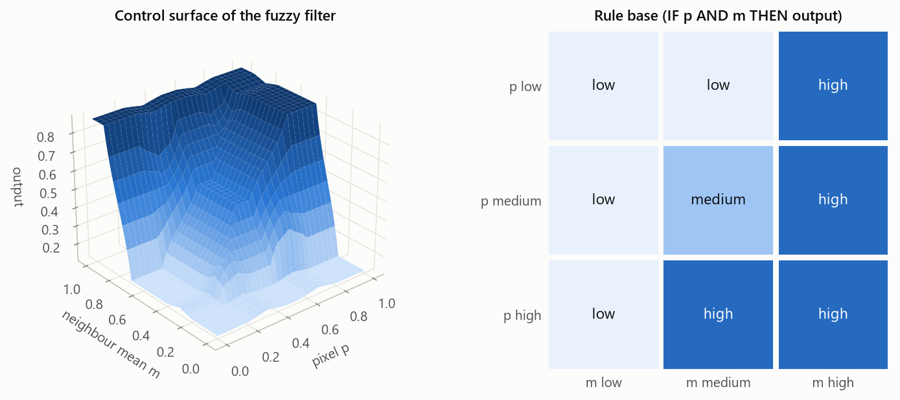

*The control surface shows the crisp output for every (p, m) pair: a 3D picture of the rule table.*

### 9.6 Application to image processing

The full enhancement stage (`fuzzy.enhance`) is: fuzzify the image → INT → rule filter → binarise.

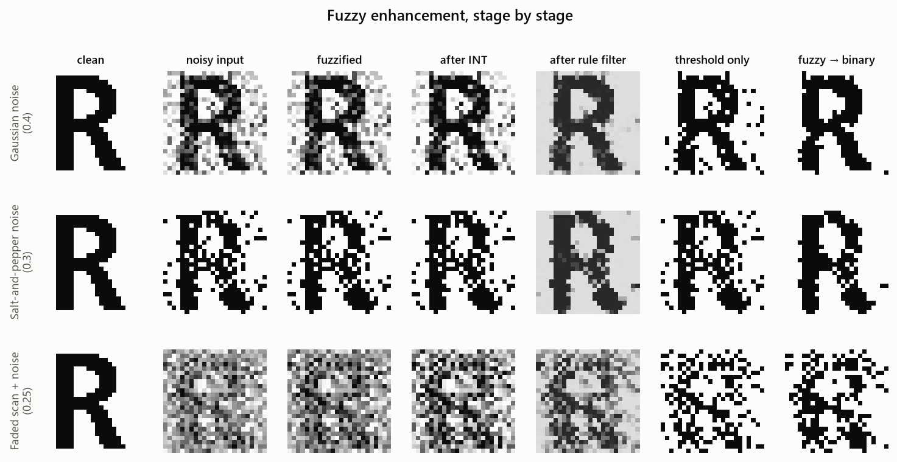

*Each row is one kind of damage. Compare the last two columns: thresholding keeps the noise, the fuzzy path removes specks and closes gaps.*

---

## 10. Syllabus topics not implemented, and how they relate

These topics are in the syllabus but not in the code. If asked, you can explain how each one connects to the project.

| Topic | How it relates to this project |
|---|---|
| McCulloch–Pitts neuron | Not a separate module, but every Hopfield, BAM and perceptron neuron *is* a McCulloch–Pitts style threshold unit (weighted sum, then a hard threshold). |
| Delta rule / Adaline | Adaline learns with the delta (LMS) rule, Δw = α(t − y_in)x, using the **net input** before the threshold. The perceptron here updates only on wrong **thresholded** outputs. An Adaline could replace the perceptron and would minimise squared error instead. |
| Madaline | Several Adalines feeding a fixed logic unit, able to learn problems that are not linearly separable. Not needed here: the training data is linearly separable, as the perceptron reaching zero errors in 3 epochs shows. |
| Back propagation | A multilayer network trained by backprop could replace the perceptron and would likely be more noise-robust. It was left out so the project stays within networks that can be checked by hand. |
| Radial basis function network | An RBF net with one Gaussian unit per template would behave like a soft Hamming net: each unit scores the distance to one glyph. |
| Continuous Hopfield | Uses graded neurons (sigmoid outputs) and continuous time. The project uses the discrete version, which matches the bipolar glyphs. The fuzzy output could feed a continuous Hopfield net as graded values (future work). |
| Kohonen SOM | Could cluster the noisy glyphs without labels, so similar characters (O, 0, Q) land near each other on a map. |
| LVQ | A supervised version of SOM: one or more prototype vectors per character, moved towards correct examples and away from wrong ones. It is a learned cousin of the Hamming net's fixed templates. |

---

## 11. Code tour, file by file

| File | What it does | Key functions and classes |
|---|---|---|
| `chars.py` | Renders A–Z and 0–9 in Consolas Bold, scales each to fit 24×24 (1-pixel margin), and binarises. Consolas is used for its slashed zero, so 0 and O differ. | `glyphs`, `render_char`, `to_bipolar`, `from_bipolar`, `GRID`, `CHARSET` |
| `noise.py` | The three kinds of damage. Every function keeps values in [0, 1]. | `gaussian`, `salt_pepper`, `faded` (paper 0.3, ink 0.6, then Gaussian), `add_noise` (dispatch by name), `mixed` (GUI) |
| `fuzzy.py` | The whole fuzzy stage. | `trapmf`, `trimf`, `fuzzify`, `fuzzify_image`, `intensify`, `neighbour_mean`, `infer`, `rule_filter`, `enhance`, `enhance_stages`, `control_surface` |
| `perceptron.py` | Multi-class perceptron with the perceptron learning rule. | `Perceptron.fit`, `net_input`, `predict` |
| `hopfield.py` | Discrete Hopfield net, Hebbian and projection rules, asynchronous recall, energy. | `Hopfield.store`, `recall` (with `record=True` for animation), `energy`, `is_fixed_point`, `match` |
| `hamming.py` | Hamming net and Maxnet. | `HammingNet.agreements`, `predict`; `Maxnet.run` |
| `bam.py` | BAM with Hadamard class codes. | `hadamard_codes`, `BAM.store`, `recall`, `classify`, `is_stable` |
| `subset.py` | Chooses which glyphs the Hebbian memories can store stably. | `greedy_order`, `memory_subset`, `fixed_point_count` |
| `models.py` | Builds and trains every network with fixed seeds, and defines the two signal paths. Shared by experiments, tests and the GUI. | `build`, `preprocess`, `predict_full`, `predict_memory`, `PIPELINES` |
| `checkpoint.py` | Tests the fuzzy stage alone: pixel errors and ink lost/added, with and without it, plus a 3×3 median filter for comparison. | `run` |
| `experiments.py` | All sweeps, figures and CSV files. | `evaluate`, `plot_*` functions |
| `selftest.py` | The 14 correctness checks. | `main` |
| `gui.py` | The interactive demo. | `App`, `PixelPanel`, `Arrow` |

**How a single recognition happens in code:**

```python
import numpy as np
import models as M
from chars import CHARSET, glyphs
from noise import add_noise

models = M.build()                                   # train / store everything (about 1 s)
noisy = add_noise(glyphs("K")[0], "faded", 0.25, np.random.default_rng(0))
x = M.preprocess(noisy, "fuzzy")                     # fuzzy path -> bipolar vector of 576
for name, idx in M.predict_full(models, x, "fuzzy").items():
    print(name, "->", CHARSET[idx[0]] if idx[0] >= 0 else "spurious")
# Perceptron -> K
# Hamming+Maxnet -> K
# Hopfield (projection) -> K
```

---

## 12. The experiments

### 12.1 What is swept

| Degradation | What it models | Levels |
|---|---|---|
| Gaussian noise | Sensor noise on every pixel | σ = 0, 0.1, …, 0.8 |
| Salt-and-pepper | Dust and dead pixels: random pixels forced to pure black or white | 0%, 10%, …, 60% of pixels |
| Faded scan | Grey paper (0.3), weak ink (0.6), plus Gaussian noise | σ = 0, 0.05, …, 0.35 |

### 12.2 How fairness is ensured

- **Same images on both paths.** At each level, one batch of noisy images is generated and fed to both the threshold path and the fuzzy path.
- **Separate seeds.** Training uses seed 2026, membership-function tuning seed 123, testing seed 11. Nothing was tuned on test data.
- **Same networks.** The only network trained on noisy data (the perceptron) gets one copy per path, each trained on its own path's output.
- **Strict scoring for memories.** A Hopfield answer counts only if the final state equals the right glyph *exactly*; a spurious state is wrong.

### 12.3 What is measured

| Measurement | Meaning |
|---|---|
| Pixel error rate | Fraction of the 576 network-input pixels that differ from the clean glyph |
| Ink lost | Stroke pixels turned into paper (holes) |
| Ink added | Paper pixels turned into ink (specks) |
| Recognition accuracy | Fraction of test images named correctly. 720 images per level for the 36-character networks, 300 for the 3-character memories |

### 12.4 Output files (in `results/`)

| File | Shows |
|---|---|
| `summary.csv` | Accuracy for every scenario, level, network and path |
| `image_quality.csv` | Pixel error, ink lost and ink added for every scenario, level and path |
| `accuracy_*.png` | Accuracy curves, one panel per network |
| `pixel_error.png`, `ink_changes.png` | Image-quality figures |
| `membership_functions.png`, `rule_surface.png`, `fuzzy_stages.png` | The fuzzy stage |
| `hopfield_energy.png`, `hopfield_capacity.png`, `maxnet.png`, `recall_samples.png` | The networks |

---

## 13. Results and what they mean

### 13.1 Image quality: the fuzzy stage cleans every kind of damage

| Damage | Pixel error, threshold | Pixel error, fuzzy | Ink lost per image | Ink added per image |
|---|---|---|---|---|
| Gaussian, σ = 0.4 | 10.5% | 4.2% | 19.5 → 13.5 | 41.0 → 10.7 |
| Salt-and-pepper, 30% | 15.0% | 7.0% | 27.8 → 21.0 | 58.5 → 19.2 |
| Faded scan, σ = 0.25 | 25.4% | 19.7% | 64.3 → 47.2 | 81.9 → 66.0 |

- **Specks:** "ink added" drops by about 70% under random noise. This is the rule "p high AND m low → low".
- **Holes:** "ink lost" drops by about a quarter to a third. This is the rule "p low AND m high → high".

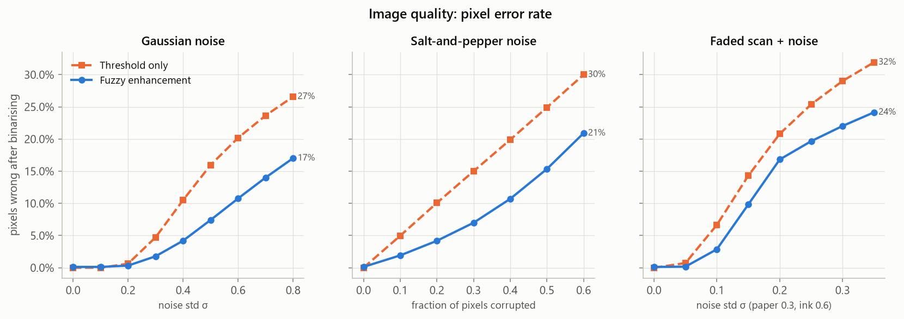

### 13.2 Recognition on faded scans: where the fuzzy stage helps most

| Network (σ = 0.25) | Threshold only | Fuzzy | Gain (points) |
|---|---|---|---|
| Perceptron | 88.1% | 94.4% | +6.4 |
| Hopfield, projection rule | 92.6% | 98.3% | +5.7 |
| BAM | 96.3% | 98.7% | +2.3 |
| Hopfield, Hebbian rule | 97.0% | 99.0% | +2.0 |
| Hamming net + Maxnet | 100% | 100% | 0 |

**Why faded scans benefit.** The fixed threshold of 0.5 sits only just below weak ink at 0.6, so a little noise pushes many stroke pixels under it. The fuzzy stage measures "ink" against the image's own range and then uses the neighbourhood, so it keeps the strokes.

**Why the Hopfield nets and BAM gain.** Their recall *starts* from the input. A cleaner start is closer to the right stable state, so recall lands there more often. The energy figure in section 6 shows this directly: the fuzzy input starts at lower energy.

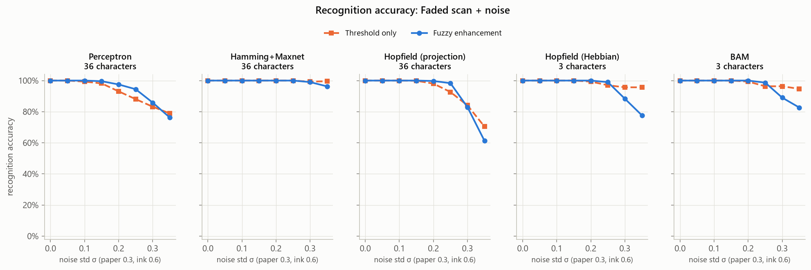

### 13.3 Random noise: little left to gain

Under Gaussian and salt-and-pepper noise, every network stays close to 100% on both paths up to σ = 0.6 and 40% salt-and-pepper. Each decision rests on all 576 pixels, so independent pixel errors largely cancel out. The fuzzy stage makes the input much cleaner, but the networks were already right.

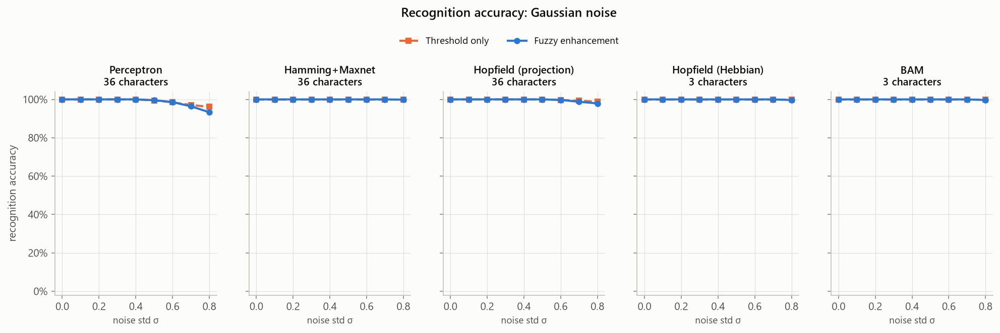
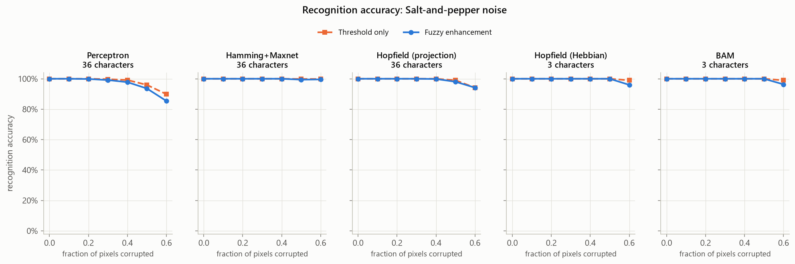

### 13.4 The limit: extreme noise

When the noise is larger than the gap between paper and ink, the neighbour mean no longer separates strokes from paper. The rules then make confident mistakes. On faded scans at σ = 0.35, the fuzzy path trails thresholding for every network (for example, projection Hopfield 70% vs 61%). At 60% salt-and-pepper it trails slightly for most networks too. This is an honest limit of a fixed 3×3 rule filter.

### 13.5 Individual examples vary

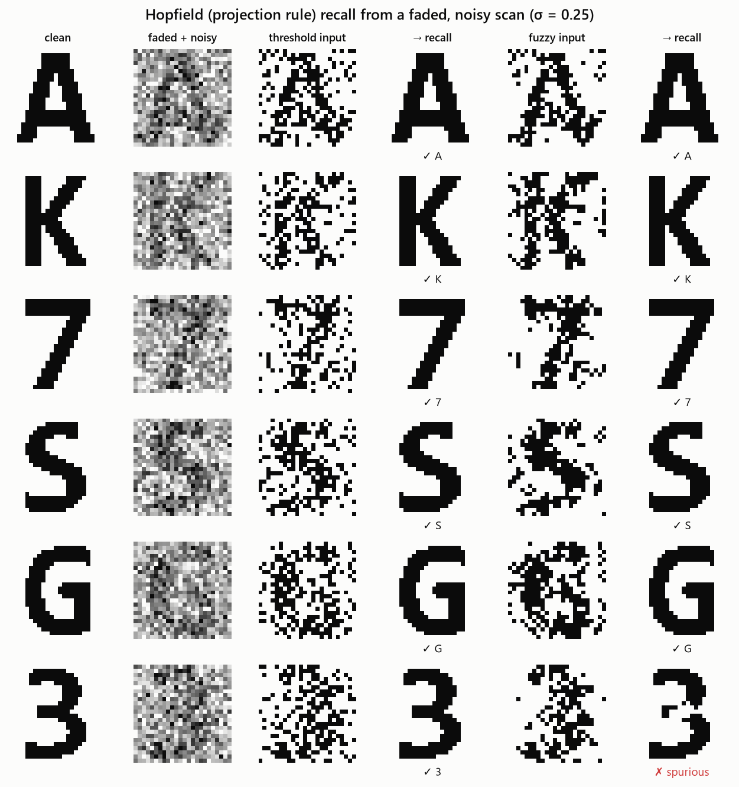

*Six random examples of Hopfield recall from faded scans (σ = 0.25). On this draw the fuzzy path misses the "3", which thresholding gets right. Single images vary; the averages above are what count.*

---

## 14. Design decisions and why they were made

| Decision | Why |
|---|---|
| **Everything from scratch in numpy** | The point of the course is to understand the algorithms. Every update rule in the code is the textbook equation, which makes it checkable by hand and in a viva. |
| **24×24 glyphs, not 16×16** | Tried first at 16×16, where strokes are 2 pixels wide. A 3×3 neighbourhood could not tell a hole in a stroke from paper beside the stroke, so the fuzzy filter removed specks but never filled holes, and recognition did not improve. At 24×24, strokes are about 3 pixels wide and the neighbourhood carries real information. |
| **Grayscale noise, not bit flips** | If noise only flipped bits in a black-and-white image, fuzzification would have nothing to work with. Grayscale noise keeps the "how dark is it" information that fuzzy sets use. |
| **Tuned membership functions** | The neighbour breakpoints were chosen by a grid search on a separate seed (123). The objective counted lost ink 1.5× more than added ink, because a missing stroke changes a letter's shape more than a stray speck. On clean glyphs the chosen settings change at most 3 of 576 pixels (0.7 on average). |
| **Adaptive fuzzification (5th–95th percentile)** | Makes the fuzzy stage work on faded scans without hand-setting the paper and ink levels. It leaves clean images unchanged. |
| **One perceptron per path** | The perceptron is the only network trained on noisy data. Training it on thresholded images and testing on fuzzy ones would penalise the fuzzy path for a mismatch, not for its quality. |
| **Projection rule for the main Hopfield net** | The Hebbian rule could only hold 3 glyphs stably. The projection rule keeps the same architecture, recall and energy, but stores all 36. It is clearly labelled as beyond the syllabus. |
| **Hadamard codes for BAM** | Orthogonal codes are as far apart as possible, so a slightly wrong recalled code still decodes to the right class. |
| **Fixed seeds everywhere** | Anyone running the code gets exactly the reported numbers. |
| **Consolas Bold font** | Its slashed zero keeps 0 and O apart. Even so, O and 0 remain the closest pair of glyphs. |

---

## 15. The interactive demo

Run `python gui.py`.

| Area | What it does |
|---|---|
| **Character keypad** | Click a key or type a character to load its glyph. Underlined keys (W, Q, D) are the ones the Hebbian Hopfield net and BAM store. |
| **Input grid** | Draw your own character: left mouse button draws, right button erases, **Clear** wipes it. |
| **Noise** | Choose Gaussian, salt-and-pepper or faded scan; set the level with the slider; **New noise sample** draws fresh noise. |
| **Signal paths** | The fuzzy path, stage by stage (noisy → fuzzified → after INT → after rule filter → network input), and the threshold path below it. The line underneath counts wrong pixels on each path. |
| **Readout table** | Every network's answer on both paths, with ✓ or ✗, plus detail: net inputs, Hamming agreements and Maxnet steps, Hopfield energy, BAM code bits. |
| **Animate recall** | Replays the projection-rule Hopfield net settling, flip by flip, on both paths, with the energy falling. |

On short screens (laptops at high scaling, projectors), the window switches to smaller pixel cells and scrolls.

**Suggested viva demo (2 minutes):**

1. Load **A** with Gaussian noise at 0.4. Point at the pixel-error line: the fuzzy path has far fewer wrong pixels.
2. Switch to **Faded scan** at 0.25 and load **K**. Show how the fuzzy stages recover the strokes.
3. Press **Animate recall** and narrate: one neuron at a time, energy never rises, it settles on the stored glyph.
4. Load **Q**, which the Hebbian memories store. Then load **A**, which they don't: the Hebbian net recalls a different stored letter or a spurious state, which is the capacity limit in action.
5. Draw your own letter on the grid and let the networks guess.

---

## 16. The self-tests

`python selftest.py` runs 14 checks. Each one tests a textbook property.

| Check | What it proves |
|---|---|
| Membership functions are valid | Every degree is in [0, 1], and every input value belongs to some set |
| Centroid of a symmetric set is its centre | Defuzzification is computed correctly (the medium/medium rule alone gives exactly 0.5) |
| INT operator properties | INT fixes 0, 0.5 and 1, is monotone, and increases contrast |
| Fuzzification leaves clean glyphs unchanged | Adaptive fuzzification does not damage good images |
| Enhancement preserves clean glyphs | The whole fuzzy stage changes under 0.5% of pixels on clean input |
| Fuzzy reduces pixel error at moderate noise | Checked for all three kinds of damage |
| Every network recognises clean inputs | Every network, including both perceptrons, scores 100% on the clean glyphs it knows |
| Stored patterns are fixed points | Projection Hopfield (36) and Hebbian Hopfield (3) |
| Hopfield weights symmetric, zero diagonal | The condition for the energy argument |
| Hopfield energy never increases | Checked step by step on real noisy recalls |
| Maxnet leaves exactly one winner | 200 random inputs, including exact ties; the winner is always the largest |
| Hamming scores equal agreement counts | The net input really is n − Hamming distance |
| BAM pairs stable in both directions | Image → code and code → image |
| Perceptrons converged | Both perceptrons finish training with zero errors |

---

## 17. Viva questions and answers

**Why use fuzzy logic for this problem?**
Whether a noisy pixel is ink is a matter of degree. Fuzzy sets keep that degree, and rules let a pixel's neighbourhood overrule a misleading value, which a hard threshold cannot do.

**What is the difference between fuzzification and the INT operator?**
Fuzzification turns a crisp value into degrees of membership. INT is an operation *on* a fuzzy set that makes it less fuzzy, pushing degrees towards 0 or 1.

**Doesn't INT followed by a 0.5 threshold do nothing?**
On its own, yes: INT keeps every value on the same side of 0.5. It matters because the rule filter runs between INT and the threshold, and the neighbour mean is computed from the sharpened image.

**Why trapezoidal membership functions?**
They are simple, have a flat core (values that are clearly "low" or "high" get full membership), and form a partition where memberships add up to 1.

**Why Mamdani inference with min and max?**
It is the standard rule-based fuzzy system in the syllabus. Min for AND means a rule is only as true as its weakest condition; max aggregation keeps the strongest conclusion for each output value.

**Why centroid defuzzification?**
It uses the whole aggregated set and changes smoothly with the inputs. Mean-of-maximum would jump between values.

**How did you choose the rule outputs and breakpoints?**
The rules come from what a person does: remove a lone speck, fill a hole surrounded by ink, otherwise trust the pixel. The breakpoints were tuned by grid search on a separate random seed, weighting lost ink 1.5× more than added ink.

**Why does the Hopfield energy always decrease?**
A neuron flips only to match the sign of its input h_i, so ΔE = −Δs_i·h_i ≤ 0. This needs symmetric weights with a zero diagonal, and asynchronous (one-at-a-time) updates.

**What is a spurious state?**
A stable state that is not one of the stored patterns, often a mixture of them. Recall can get stuck there.

**Why could the Hebbian Hopfield net store only 3 glyphs when the theory says 0.138n ≈ 79?**
That figure is for random, uncorrelated patterns. Glyphs share a large background and many stroke positions, so crosstalk between them swamps each pattern's own signal.

**What is the projection rule? Is it in the syllabus?**
W = P⁺P, using the pseudo-inverse of the pattern matrix. It removes the crosstalk, so every stored pattern is stable. It is not in the syllabus; it was added as an extension after the Hebbian capacity limit was found.

**Synchronous vs asynchronous updating?**
Synchronous updates every neuron at once and can oscillate between two states. Asynchronous updates one at a time and is guaranteed to settle, which is why the code uses it.

**How does the Hamming net differ from the Hopfield net?**
The Hamming net is a feed-forward classifier: it scores the input against each template and returns the class. It needs m × n weights (36 × 576). The Hopfield net is recurrent and returns the pattern itself, with n × n weights (576 × 576).

**How do you choose ε in Maxnet, and what about ties?**
It must satisfy 0 < ε < 1/m, otherwise every unit can be driven to zero at once. The code uses 1/(2m). Exact ties are broken by a tiny index-based offset.

**Why are BAM codes Hadamard rows?**
They are mutually orthogonal, so the codes are as far apart as possible and easy to decode even when slightly wrong.

**How is the perceptron different from Adaline?**
The perceptron updates only when its *thresholded* output is wrong. Adaline uses the delta rule on the *net input*, minimising squared error even when the output is already right.

**Why was the perceptron trained twice?**
So that each path's perceptron is tested on the kind of input it learned from. Otherwise the comparison would measure a train/test mismatch, not the fuzzy stage.

**Why 24×24 and not a smaller grid?**
At 16×16 the strokes were 2 pixels wide, and a 3×3 neighbourhood could not tell a hole in a stroke from paper next to it.

**Does the fuzzy stage always help?**
No. It always produces cleaner images at moderate noise, and it improves recognition most on faded scans. Under random noise the networks were already near 100%. At the most extreme noise the fuzzy path trails, because the neighbourhood is too noisy to trust.

**Why are the networks so robust to random noise?**
Each decision combines all 576 pixels. Independent errors push in random directions and largely cancel, like averaging many noisy measurements.

**What would you do next?**
Feed the fuzzy output to the networks as graded values instead of a binary image; tune the membership functions automatically with a neuro-fuzzy method such as ANFIS; and test on real scanned handwriting.

---

## 18. Glossary

| Term | Meaning |
|---|---|
| Bipolar vector | A vector of +1 and −1 values; here +1 = ink, −1 = paper |
| Hamming distance (HD) | Number of positions where two vectors differ |
| Template | The clean stored version of a character |
| Fixed point / stable state | A state that a recurrent network does not change when updated |
| Spurious state | A stable state that is not one of the stored patterns |
| Crosstalk | Interference from other stored patterns in a neuron's input |
| Firing strength | How true a fuzzy rule's IF part is, from 0 to 1 |
| Implication (clipping) | Cutting a rule's output set at its firing strength |
| Aggregation | Combining all rules' clipped output sets into one, with max |
| Centroid | The centre of gravity of a fuzzy set: the defuzzified output |
| Fuzzy partition | Sets whose memberships add up to 1 at every value |
| Signal path | The route from noisy image to network input: threshold-only or fuzzy |
| Seed | The starting number for the random generator; fixing it makes runs repeatable |
